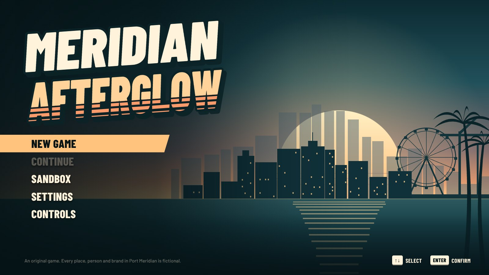
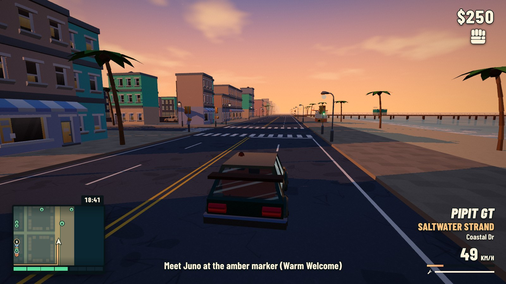
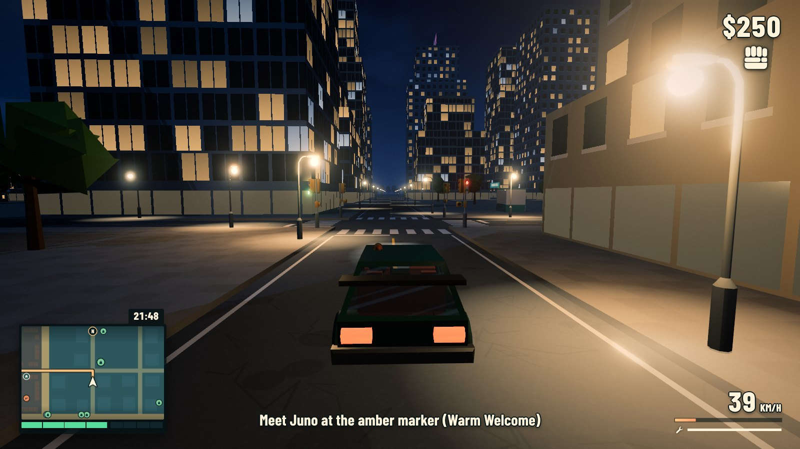
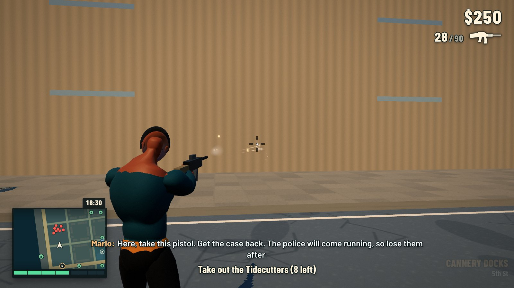
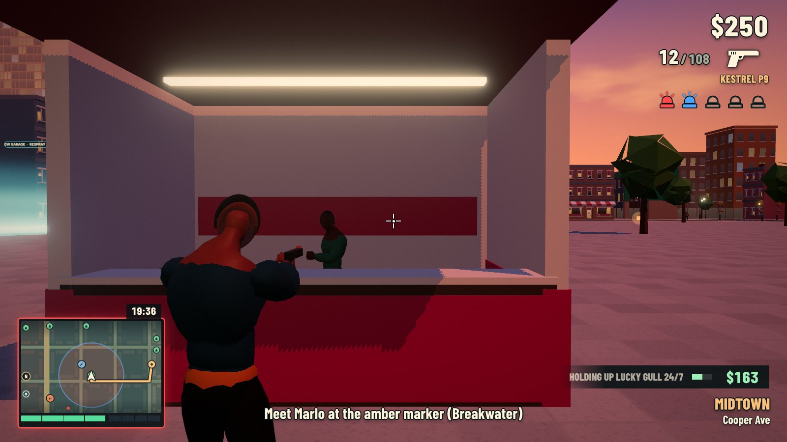
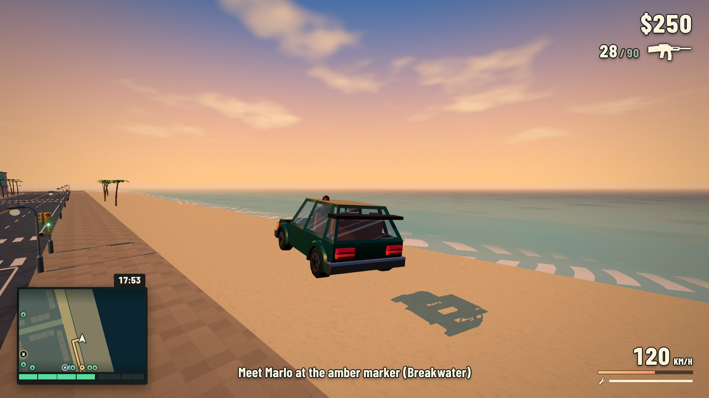
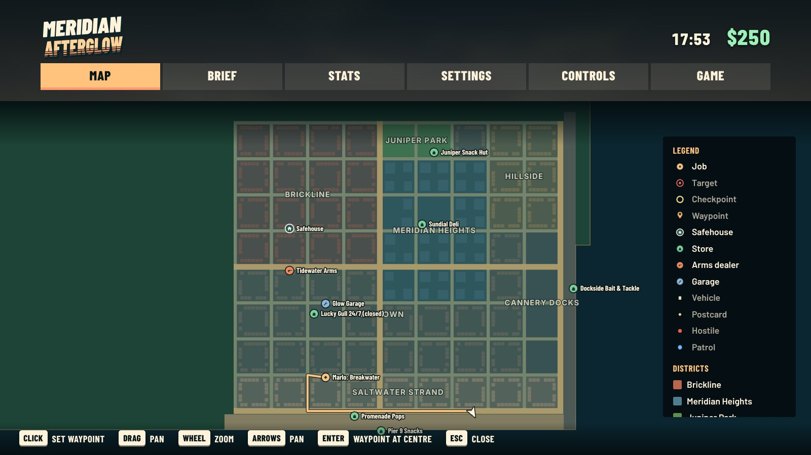

# Meridian Afterglow

An original open-world action game that runs in the browser. Explore **Port Meridian**, a compact coastal city of seven districts, at golden hour and beyond: steal cars, drive, fight, shake off the police, and work through five story missions for Juno, Marlo and Vesna.

**Play:** https://jcorrea510.github.io/astratest/ (desktop Chrome, Safari or Firefox; keyboard + mouse or a gamepad).

Everything in the game is original: the city, districts, streets, brands, characters, story, user interface and music. It uses CC0 3D models and animations (see [CREDITS.md](CREDITS.md)). Tone is Teen: stylised action, no gore.

## Screenshots

| | |
| --- | --- |
|  |  |
|  |  |
|  |  |
|  | |

Captured from the production build in software rendering (high preset); a real GPU looks the same but runs much faster.

## What's in the game

- **On foot:** weighty third-person movement (walk/jog/sprint with momentum and plant-and-pivot turns, variable-height jumps with jump buffering, climbing onto car roofs and low walls, dodge roll, landing rolls, swimming in the sea and harbor), a smooth collision-aware camera with a sprint FOV kick, and over-the-shoulder aiming.
- **Driving:** enter and exit any vehicle (or take it from its driver). Seven vehicles that handle differently (Solano Sedan, Meridian Cab, Pipit Hatch, Pipit GT, Estero Wagon, Dray Box Van, MPD Interceptor) with a load-sensitive tyre model (wheelspin, holdable handbrake drifts, speed-sensitive steering, a stability assist, self-righting after a flip), sprung body motion, glass windshields with visible interiors and drivers, collisions, visible crumple damage, smoke, fire and explosions, glowing head/tail/brake lights, tyre marks and a horn. Cars driven into deep water flood and sink.
- **Traffic** that follows lanes and traffic lights, keeps its distance, slows for corners, honks, and panics when shot at.
- **Combat:** fists plus four guns that each feel distinct (Kestrel P9 pistol, Mako Compact SMG, Breaker 12 shotgun, Longline Carbine), with first-shot accuracy, spread bloom, recoil with smooth recovery, damage falloff and headshots, shell-by-shell shotgun reloads, tracers, layered muzzle flashes, casings, surface-aware impacts, and layered synthesized gunshots with echoes off nearby walls. Health and armor.
- **Inventory wheel:** hold Tab (or LB) to open a radial weapon/item wheel; the city slows down while you choose.
- **People:** pedestrians with varied bodies, faces, hair and outfits, blended animation with stride-matched feet; they walk the sidewalks, wait for crossing signals, dodge cars, flee gunfire and cower. Gang members and police take cover, flank, fire in bursts and reload.
- **Heat:** crimes raise your heat level (0–5); the police response escalates from foot patrols to armed units and ramming cruisers. Break line of sight and leave the search area to lose it, or get a respray at the Glow Garage.
- **City:** seven districts (Brickline, Meridian Heights, Juniper Park, Hillside, Cannery Docks, Saltwater Strand, Midtown), a pier with a Ferris wheel, beach, docks with cranes, storefronts with invented brands, billboards, a full day–night cycle with working street lights, car lights and lit windows, and ambient sound plus three procedural radio stations.
- **Things to do:** five missions (a timed delivery, a tailing job, a dockside shootout and escape, a car theft under heat, and a city-wide street race), 12 hidden sunset postcards, 3 stunt jumps, five street kiosks you can hold up (aim at the clerk, keep them covered while the till empties, grab the cash before the police arrive; some clerks fight back), Tidewater Arms (weapons, ammo, armor, first-aid kits), Pier 9 Snacks, the Glow Garage respray, and a safehouse.
- **Sandbox mode:** pick Sandbox on the title screen for free play with everything unlocked ($50,000, every weapon, invincible) and a tools panel in the pause menu: wanted level, police ignore you, time of day and clock, traffic and pedestrian density, spawn any vehicle, repair, teleport. Sandbox games are not saved.
- **Menus & HUD:** a bold, original open-world presentation: title screen, loading screen with tips, radar minimap with segmented health/armor, outlined money with deltas, wanted beacons, mission splash cards, a tabbed pause menu (map, brief, stats, settings, controls), settings (graphics quality, sensitivity, invert Y, field of view, camera shake, volumes, FPS counter, full key rebinding), controls help, rotating minimap, full city map with waypoints, autosave and manual save, mission cards and subtitles. Phones get a clean "play this on a computer" screen.

## Controls

| Action | Keyboard / mouse | Gamepad |
| --- | --- | --- |
| Move / steer | W A S D | Left stick |
| Look | Mouse | Right stick |
| Accelerate / brake & reverse (in a vehicle) | W / S | RT / LT |
| Fire / punch | Left mouse | RT |
| Aim | Right mouse | LT |
| Sprint | Left Shift | A |
| Jump · Handbrake (in a vehicle) | Space | B · A |
| Dodge roll | Left Ctrl or C | L3 |
| Enter / exit vehicle | F | Y |
| Interact / shop / save | E | X |
| Reload | R | X |
| Inventory wheel (hold) | Tab or Q | LB |
| Next / previous weapon | Mouse wheel | RB |
| Horn · Headlights · Radio | H · L · . | L3 · D-pad ↓ · D-pad ↑ |
| Camera distance | B | D-pad → |
| City map | M | View |
| Pause | Esc or P | Menu |

All keyboard and mouse bindings can be changed in **Settings → Key bindings**.

## Run, test, build

Requires Node 22+.

```bash
npm install
npm run dev -- --host 0.0.0.0   # http://localhost:5173/astratest/
npm run typecheck                # TypeScript
npm run lint                     # ESLint
npm test                         # unit tests (Vitest)
npm run build                    # production build into dist/
npm run test:e2e                 # browser tests: builds, serves /astratest/ and plays the game with scripted input
npm run test:soak                # 20 minutes (game time) of scripted chaos with memory checks
```

The browser tests drive the real production build at the `/astratest/` subpath: title screen to gameplay, walking/driving/crashing, combat, the inventory wheel, gaining and losing heat, death and arrest, every mission start to finish, save and continue, settings persistence, and the mobile screen. `?autostart=1` skips the title screen (add `&sandbox=1` for sandbox mode); `?quality=low|medium|high` overrides the graphics preset.

## Run it locally

The game is the same code whether you play it on GitHub Pages or on your own machine. Running it locally mainly removes the network loading (models, textures and sounds come off your disk), and the page never waits on the server; frame rate depends on your GPU either way. For the smoothest play also pick **High** in Settings (or **Low** on weaker machines) and press the fullscreen button in the top-right corner.

You need [Node.js 22+](https://nodejs.org). Then either:

1. **From GitHub:** on the repository page choose **Code → Download ZIP** and unzip it (or `git clone https://github.com/jcorrea510/astratest.git`), open a terminal in that folder and run:

   ```bash
   npm install
   npm run local        # builds, starts a local server and opens http://127.0.0.1:4180/
   ```

   `npm run local` is the same as `npm run build && npm run preview` but built for the root path, so no sub-folder is needed. If you prefer the manual way: `npm run build`, then `npm run preview` and open `http://localhost:4173/astratest/`.

2. **Prebuilt, no Node build step:** download the `gh-pages` branch as a ZIP (**Code → switch branch to `gh-pages` → Download ZIP**). The site expects to live under `/astratest/`, so make a folder, put the unzipped files in a sub-folder named `astratest`, and serve the outer folder with any static server, for example `npx serve outer-folder` or `python3 -m http.server 8000`, then open `http://localhost:8000/astratest/`.

Keep the page in a normal browser window (Chrome, Edge, Safari, Firefox); opening `index.html` by double-clicking does not work because browsers block module scripts from `file://`.

### iPad

Open the live link in Safari with a Bluetooth keyboard and mouse, or a paired game controller. iPad starts on the Low graphics preset to stay under Safari's memory limit; raise it in Settings if it holds up. If Safari refuses mouse capture the cursor and finger-drag look around instead.

## Deploy

`.github/workflows/deploy.yml` runs on every push to `main`: typecheck, lint, unit tests, build, browser tests, then publishes `dist/` to the `gh-pages` branch, which GitHub Pages serves at https://jcorrea510.github.io/astratest/. Nothing is published if any check fails.

If Pages ever needs re-enabling: repository **Settings → Pages → Build and deployment → Source: Deploy from a branch → `gh-pages` / root**.

## Performance budgets

Quality presets (Low / Medium / High) scale resolution, shadows (none / 2048 / 4096), bloom, MSAA, draw distance, crowd and traffic density, and dynamic lights. Targets for Medium on an Apple M1 MacBook Air at 60 fps: ≤ 350 draw calls and ≤ 1 M triangles per frame (measured 184–311 calls and 0.46–0.89 M triangles across districts in software rendering), ≤ 64 MB of textures, bounded particle and entity pools. The first download is about 6 MB (2.7 MB of JS, mostly the physics engine, plus models, animations and sounds), with a progress bar.

## Code map

- `src/world` – city layout (pure data, tested), city mesh/collider builder, asset loading
- `src/render` – renderer, sky and time of day, procedural materials, particles
- `src/actors` – people (rig, outfits, faces, animation), character controller, NPC brains
- `src/vehicles` – vehicle physics, specs and visuals
- `src/combat` – weapons and hitscan combat
- `src/game` – game loop, player, camera, traffic, police, population, missions, activities, saves
- `src/ui` – menus, HUD, minimap, map, wheel, shop; `src/audio` – synthesized sound, engines, ambience, radio
